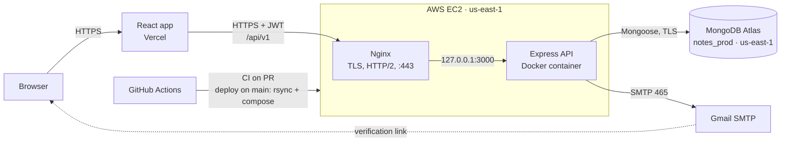
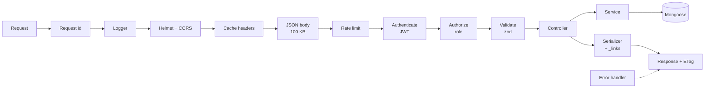
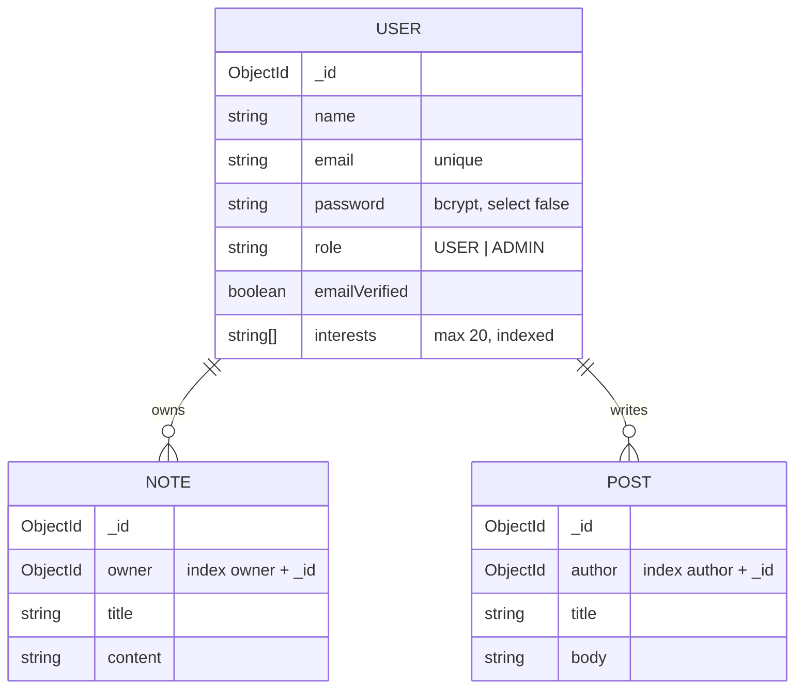

# Secure Notes API

Backend for the Secure Notes take-home task. Users write private notes and public posts, and admins manage users and can read everyone's notes.

Built with Node.js, TypeScript, Express 5 and MongoDB (Mongoose). No framework, no starter template.

- **Live API:** https://note-backend.myftp.org
- **API docs (Swagger):** https://note-backend.myftp.org/docs
- **Health check:** https://note-backend.myftp.org/health
- **Frontend:** _add Vercel URL_ · repo: _add frontend repo URL_

---

## Contents

1. [High-level design](#high-level-design)
1. [Test credentials](#test-credentials)
1. [Running it locally](#running-it-locally)
1. [Environment variables](#environment-variables)
1. [Scripts](#scripts)
1. [Project structure](#project-structure)
1. [Endpoints](#endpoints)
1. [Roles and access](#roles-and-access)
1. [Scenario 1: users grouped by interests](#scenario-1-users-grouped-by-interests)
1. [Scenario 2: a user's posts with $lookup](#scenario-2-a-users-posts-with-lookup)
1. [Indexing strategy](#indexing-strategy)
1. [Pagination and response format](#pagination-and-response-format)
1. [Security](#security)
1. [Caching, request ids and logs](#caching-request-ids-and-logs)
1. [Tests](#tests)
1. [CI/CD and deployment](#cicd-and-deployment)
1. [Decisions and trade-offs](#decisions-and-trade-offs)
1. [What I'd do next](#what-id-do-next)

---

## High-level design



The parts and what each one does:

| Part                     | Role                                                                                                                                           |
| ------------------------ | ---------------------------------------------------------------------------------------------------------------------------------------------- |
| **React app (Vercel)**   | The UI. It only talks to the API and stores the JWT on the client.                                                                             |
| **Nginx**                | Terminates HTTPS (Let's Encrypt), redirects HTTP to HTTPS, and proxies to the container. It's the only thing reachable from outside on 80/443. |
| **Express API (Docker)** | All the business logic. It's stateless, since the JWT carries the user id and role, so nothing is kept in memory between requests.             |
| **MongoDB Atlas**        | Stores users, notes and posts. It's in the same AWS region as the server and only accepts the server's IP.                                     |
| **Gmail SMTP**           | Sends verification emails. The link opens the frontend, which calls `/auth/verify-email`.                                                      |
| **GitHub Actions**       | Runs checks on every PR and deploys to EC2 when `main` changes.                                                                                |

### Inside the API

A request goes through the middleware in this order:



- **Request id, logger, security headers and cache headers** run for every request.
- **Rate limiting** applies to everything under `/api/v1`, with a stricter limit on `/auth`.
- **Authenticate and authorize** only run on protected routers. `authorize('ADMIN')` guards the whole `/admin` router.
- **Validate** checks params, query and body with zod before the controller runs, so controllers only see clean input.
- **Controller → service → model:** controllers handle HTTP, services hold the queries and rules, and models define the schemas and indexes.
- **Serializers** shape each response and add the `_links` the caller is allowed to use.
- **Any thrown error** goes to one error handler, which returns `{ statusCode, message, requestId }`.

### Data model



Notes and posts are separate collections that reference the user, rather than arrays embedded in the user document. That way they can grow without limit, be paginated with an index, and be deleted with the user in one transaction.

### Main flows

**Register and log in**

1. `POST /auth/register` hashes the password, creates a `USER` with `emailVerified: false`, and emails a signed link (valid 24 h).
2. The user opens the link. The frontend sends the token to `POST /auth/verify-email`, and the account is marked verified.
3. `POST /auth/login` checks the password and returns a JWT (1 day) with the user id and role.
4. The frontend sends `Authorization: Bearer <token>` on every request after that.

**Reading a list**

1. The JWT is checked and the user is attached to the request.
2. The query is validated (`page`, `limit` ≤ 100).
3. The service runs the find and the count in parallel, both using the same index.
4. The response gets pagination links and an ETag. If the browser's copy is still current, the server sends 304.

**Deleting a user (admin)**

1. Checks that the caller is an admin and isn't deleting themselves.
2. Deletes the user, their notes and their posts inside one transaction. Either everything is removed or nothing is.

---

## Test credentials

| Role  | Email         | Password         |
| ----- | ------------- | ---------------- |
| Admin | _admin email_ | _admin password_ |
| User  | _user email_  | _user password_  |

You can also register a new account. A verification email is sent and you have to click the link before you can log in.

---

## Running it locally

You need Node 22 (see `.nvmrc`) and a MongoDB connection string. MongoDB has to be a replica set because deleting a user runs in a transaction. Atlas is a replica set by default.

```bash
git clone <this repo>
cd notes_backend
npm install
cp .env.example .env     # then fill in the values
npm run dev
```

The API runs on http://localhost:3000 and the docs on http://localhost:3000/docs.

On startup the server connects to MongoDB, builds the indexes, creates the first admin from `ADMIN_EMAIL` / `ADMIN_PASSWORD` if it doesn't exist yet, and then starts listening.

If SMTP isn't configured in development, verification emails are printed to the console instead of being sent, so you can copy the link from there.

### With Docker

```bash
npm run docker:up
```

This builds the production image and runs it with Docker Compose using your `.env`.

### Sample data

```bash
npm run seed      # 200 users, 1,000 notes, 600 posts (emails end in @seed.local)
npm run explain   # prints the explain() result of every main query
npm run seed -- --clean   # removes only the seed data
```

---

## Environment variables

All variables are validated with zod when the app starts. If something is missing or wrong, the app prints what it is and exits instead of failing later.

| Variable                                              | Required      | Notes                                                         |
| ----------------------------------------------------- | ------------- | ------------------------------------------------------------- |
| `NODE_ENV`                                            | no            | `development` (default), `test`, `production`                 |
| `PORT`                                                | no            | default `3000`                                                |
| `MONGO_URI`                                           | yes           | Atlas connection string, including the database name          |
| `CORS_ORIGIN`                                         | yes           | the frontend URL, the only origin allowed by CORS             |
| `FRONTEND_URL`                                        | yes           | used to build the link in the verification email              |
| `JWT_ACCESS_SECRET`                                   | yes           | at least 32 characters                                        |
| `JWT_ACCESS_EXPIRES_IN`                               | no            | default `1d`                                                  |
| `JWT_VERIFY_SECRET`                                   | yes           | at least 32 characters, different from the access secret      |
| `SMTP_HOST` / `SMTP_PORT` / `SMTP_USER` / `SMTP_PASS` | in production | Gmail: `smtp.gmail.com`, `465`, your address, an App Password |
| `MAIL_FROM`                                           | no            | sender shown in the email                                     |
| `ADMIN_EMAIL` / `ADMIN_PASSWORD`                      | no            | first admin, created once on startup                          |

Generate secrets with `openssl rand -hex 32`. The `.env` file is git-ignored and is never copied into the Docker image.

---

## Scripts

| Script                            | What it does                      |
| --------------------------------- | --------------------------------- |
| `npm run dev`                     | run with reload                   |
| `npm run build`                   | compile TypeScript to `dist/`     |
| `npm start`                       | run the compiled build            |
| `npm run lint`                    | ESLint                            |
| `npm run format` / `format:check` | Prettier                          |
| `npm run typecheck`               | `tsc --noEmit`                    |
| `npm test`                        | integration tests (Vitest)        |
| `npm run seed`                    | load sample data                  |
| `npm run explain`                 | print query plans                 |
| `npm run docker:up`               | build and run with Docker Compose |

---

## Project structure

The code is split by feature. Each module has its model, zod schemas, service (database logic), controller (HTTP in and out), routes and a serializer that shapes the response.

```
src/
  app.ts                 express app and middleware order
  server.ts              connect, build indexes, seed admin, listen
  config/env.ts          env validation
  middleware/            request id, logger, auth, roles, validation, cache headers, rate limits, errors
  modules/
    auth/                register, verify email, resend verification, login
    users/               user model, profile, Scenario 1
    notes/               note model and CRUD
    posts/               post model, CRUD, Scenario 2
    admin/               user management, all notes
    mail/                nodemailer wrapper
  seed/                  admin seed, bulk seed, explain script
  utils/                 errors, pagination and links, tokens, shared schemas
test/                    integration tests
docs/                    OpenAPI spec, SRS, models, ER diagram
```

Controllers stay thin: they read the validated input, call a service and send the result. All the database work is in the services, which is what the tests exercise.

---

## Endpoints

All routes are under `/api/v1` except `/health` and `/docs`. The full spec with request and response bodies is in `docs/openapi.yaml` and on `/docs`.

| Method               | Path                          | Who    | What                                              |
| -------------------- | ----------------------------- | ------ | ------------------------------------------------- |
| GET                  | `/health`                     | anyone | health check                                      |
| POST                 | `/auth/register`              | anyone | create a USER account, sends a verification email |
| POST                 | `/auth/verify-email`          | anyone | verify with the token from the email              |
| POST                 | `/auth/resend-verification`   | anyone | send a new verification link                      |
| POST                 | `/auth/login`                 | anyone | returns a JWT                                     |
| GET                  | `/users/me`                   | user   | my profile                                        |
| PATCH                | `/users/me`                   | user   | update my name and interests                      |
| GET                  | `/users/grouped-by-interests` | user   | **Scenario 1**                                    |
| GET                  | `/users/:id/posts`            | user   | **Scenario 2**                                    |
| POST                 | `/notes`                      | user   | create a note                                     |
| GET                  | `/notes`                      | user   | my notes, newest first                            |
| GET / PATCH / DELETE | `/notes/:id`                  | owner  | one of my notes                                   |
| POST                 | `/posts`                      | user   | create a post                                     |
| GET                  | `/posts/:id`                  | user   | one post                                          |
| PATCH / DELETE       | `/posts/:id`                  | author | edit or delete my post                            |
| GET                  | `/admin/users`                | admin  | all users                                         |
| PATCH                | `/admin/users/:id`            | admin  | change name, role, interests                      |
| DELETE               | `/admin/users/:id`            | admin  | delete a user with their notes and posts          |
| GET                  | `/admin/notes`                | admin  | everyone's notes with the owner's name            |

Protected routes need `Authorization: Bearer <token>`.

---

## Roles and access

There are two roles, `USER` and `ADMIN`. An admin can do everything a user can, plus the `/admin` routes.

- **Registration always creates a `USER`.** The role isn't accepted from the request body (the schemas are strict, so unknown fields are rejected), so nobody can register as an admin.
- **The first admin comes from env** (`ADMIN_EMAIL`, `ADMIN_PASSWORD`) and is created once on startup. Other admins are made by promoting a user with `PATCH /admin/users/:id`.
- **Notes are private.** Every note query includes the owner: `{ _id, owner: userId }`. If you ask for someone else's note you get 404, not 403, so you can't tell whether the note exists.
- **Posts are readable by any logged-in user**, but only the author can edit or delete them.
- **Admins can read all notes but not edit them.** They can change a user's name, role and interests, but not their email or password, since those belong to the account owner.
- **An admin can't demote or delete themselves**, so the system can't be left without an admin by accident.
- **Deleting a user** removes their notes and posts in the same transaction, so there's no orphaned data if something fails halfway.

---

## Scenario 1: users grouped by interests

`GET /users/grouped-by-interests?interests=chess,reading&page=1&limit=10`

The brief says to use exactly one `aggregate()` call and nothing else. That rules out a separate `countDocuments` for the total, so the count also has to come out of the same pipeline. `$facet` does that.

```js
User.aggregate([
  { $match: { interests: { $in: interests } } }, // only when filtering; uses the interests index
  { $project: { name: 1, interests: 1 } }, // small documents, no password hash
  { $unwind: '$interests' }, // one document per user + interest
  { $match: { interests: { $in: interests } } }, // only when filtering; drop the interests not asked for
  {
    $group: {
      _id: '$interests',
      count: { $sum: 1 },
      users: { $push: { _id: '$_id', name: '$name' } },
    },
  },
  { $sort: { count: -1, _id: 1 } }, // most popular first, stable order for paging
  {
    $facet: {
      meta: [{ $count: 'total' }],
      data: [
        { $skip: skip },
        { $limit: limit },
        { $project: { _id: 0, interest: '$_id', count: 1, users: 1 } },
      ],
    },
  },
]);
```

Why each stage is there:

- The first `$match` only works with an index while it's at the start of the pipeline, so it goes first.
- `$project` comes before `$unwind` because `$unwind` multiplies documents. It also keeps the password hash out, because aggregations ignore `select: false`.
- The second `$match` is needed because a user who likes chess and music still produces a "music" document after `$unwind`. Without it, filtering by chess would also return music.
- The `_id` tie-break in `$sort` keeps pages stable when two interests have the same count.
- The `interests` query string is trimmed, lowercased and de-duplicated the same way stored interests are, so `?interests=Chess, MUSIC` matches.

Without a filter, the pipeline has to read every user. There's no index that makes "read everything" cheaper. At a larger scale I'd precompute the groups into a summary collection with `$merge`.

---

## Scenario 2: a user's posts with $lookup

`GET /users/:id/posts?page=1&limit=10`

One pipeline on `users` that pulls in the posts with `$lookup`:

```js
User.aggregate([
  { $match: { _id: userId } },
  { $project: { name: 1 } },
  { $lookup: {
      from: 'posts',
      localField: '_id',
      foreignField: 'author',
      as: 'posts',
      pipeline: [
        { $sort: { _id: -1 } },
        { $facet: { meta: [{ $count: 'total' }], data: [{ $skip: skip }, { $limit: limit }] } },
      ],
  } },
  { $unwind: '$posts' },
  { $project: { user: { _id: '$_id', name: '$name' }, total: ..., data: '$posts.data' } },
]);
```

- Starting from `users` means a user who doesn't exist returns 404, while a user with no posts returns 200 with an empty list.
- `localField` / `foreignField` together with an inner `pipeline` lets MongoDB use the `{ author: 1, _id: -1 }` index for both the match and the sort.
- The `$sort` is placed before `$facet` so it runs on the index instead of in memory.
- Pagination happens inside the lookup, so the posts are never all loaded and then sliced.

---

## Indexing strategy

The brief grades unnecessary indexes, so I only added an index when a real query needed it. Every index is declared with `schema.index()`.

| Collection | Index                    | Used by                                                      |
| ---------- | ------------------------ | ------------------------------------------------------------ |
| users      | `{ email: 1 }` unique    | login, register (and it enforces unique emails)              |
| users      | `{ interests: 1 }`       | Scenario 1 when filtering (multikey: one entry per interest) |
| notes      | `{ owner: 1, _id: -1 }`  | my notes list and its count                                  |
| posts      | `{ author: 1, _id: -1 }` | Scenario 2                                                   |
| all        | default `_id`            | get/update/delete by id, admin lists                         |

A few choices worth explaining:

- **Sorting by `_id` instead of `createdAt`.** ObjectIds start with a timestamp, so `_id: -1` is already "newest first". That lets `{ owner: 1, _id: -1 }` handle both the filter and the sort, and I don't need a separate `createdAt` index.
- **Equality first, then sort** (the ESR rule): `owner` is the equality match and `_id` is the sort, so the index returns documents already in order and there's no in-memory sort.
- **No `{ owner: 1 }` on its own.** It would be a prefix of the compound index, so it would be pure overhead.
- **Admin lists** sort by `_id` with no filter, which the default `_id` index already covers. The total uses `estimatedDocumentCount()`, which reads collection metadata instead of counting.
- **Single note lookups** `{ _id, owner }` use the `_id` index. The owner check happens on the one document found.

### Proof with explain()

After `npm run seed` (about 1,800 documents), `npm run explain` gives:

| Query                         | Plan            | Index                     | Keys read | Docs read |
| ----------------------------- | --------------- | ------------------------- | --------- | --------- |
| Login by email                | IXSCAN          | `email_1`                 | 1         | 1         |
| My notes, page 1              | IXSCAN, no SORT | `owner_1__id_-1`          | 5         | 5         |
| My notes count                | COUNT_SCAN      | `owner_1__id_-1`          | 5         | 0         |
| Get one note                  | IXSCAN          | `_id_`                    | 1         | 1         |
| Admin users                   | IXSCAN          | `_id_`                    | 10        | 10        |
| Admin notes                   | IXSCAN          | `_id_`                    | 10        | 10        |
| Scenario 1, filtered by chess | IXSCAN          | `interests_1`             | 53        | 53        |
| Scenario 1, no filter         | COLLSCAN        | none                      | 0         | 203       |
| Scenario 2                    | EXPRESS_IXSCAN  | `_id_`, `author_1__id_-1` | 4         | 4         |

Keys read equals docs read equals results on every indexed query, and there's no SORT stage anywhere. The only collection scan is the unfiltered grouping, which has to read every user by definition.

---

## Pagination and response format

Every list takes `page` (default 1) and `limit` (default 10, max 100) and returns:

```json
{
  "data": [ ... ],
  "page": 2,
  "limit": 10,
  "total": 43,
  "totalPages": 5,
  "_links": {
    "self":  { "href": "/api/v1/notes?page=2&limit=10" },
    "first": { "href": "/api/v1/notes?page=1&limit=10" },
    "prev":  { "href": "/api/v1/notes?page=1&limit=10" },
    "next":  { "href": "/api/v1/notes?page=3&limit=10" },
    "last":  { "href": "/api/v1/notes?page=5&limit=10" }
  }
}
```

Single resources also have `_links`, and they only include actions the caller is allowed to take. For example, a post only has `update` and `delete` links if you're the author, and an admin doesn't get a `delete` link on their own user row. A frontend can show or hide buttons based on the links instead of repeating the permission rules.

Errors always look like this:

```json
{ "statusCode": 404, "message": "Note not found", "requestId": "3f1c9a2e-..." }
```

---

## Security

- **Passwords** are hashed with bcrypt (cost 12). The hash has `select: false` on the model, so it's only loaded for login, and it's stripped from every JSON response.
- **Login** returns the same 401 message for a wrong email and a wrong password. When the email doesn't exist, it still runs a bcrypt compare against a dummy hash, so the response time doesn't reveal which emails are registered.
- **JWT** uses HS256 (the algorithm is pinned when verifying), carries only `sub` and `role`, and expires after 1 day.
- **Email verification** uses a separate secret and a `purpose` claim, so a verification token can't be used as an access token and the other way round. Tokens aren't stored in the database.
- **Resend verification** gives the same answer whether the email exists or not.
- **Validation:** every body, query and path param goes through a strict zod schema. Unknown fields are rejected, ids must be valid ObjectIds, and the JSON body is limited to 100 KB.
- **Headers and CORS:** helmet sets the security headers, and CORS only allows the frontend's origin.
- **Rate limits** per IP: 100 requests per minute on the API, 10 per minute on auth routes. Over the limit you get 429.
- **Database:** the Atlas user can only read and write the two app databases, and Atlas only accepts the server's IP.
- **Server:** only ports 22 (key-only SSH), 80 and 443 are open. The container listens on `127.0.0.1:3000`, so the only way in is through Nginx over HTTPS.
- **Secrets** live in `.env` (git-ignored, `chmod 600` on the server). They're not in the repo, the Docker image or GitHub Actions.

---

## Caching, request ids and logs

- **Reads** (`GET` on authenticated routes) send `Cache-Control: private, no-cache` and an `ETag`. The browser can keep the response but must check with the server before using it. If nothing changed, the server answers `304 Not Modified` with no body. `private` stops shared caches from storing user data, and `Vary: Authorization` keeps different users' responses apart.
- **Everything else** sends `Cache-Control: no-store`.
- **Request ids:** every response has an `X-Request-Id` header. If the client sends a valid one it's reused, otherwise a UUID is generated. The same id is in the log line and in error bodies, so an error a user reports can be matched to the exact log entry.
- **Logs** are one JSON line per request with the method, path, status, duration and request id. Unexpected errors log the stack trace on the server, but the client only gets a generic 500.

---

## Tests

```bash
npm test
```

18 integration tests with Vitest and Supertest. They run against a real MongoDB started in memory by `mongodb-memory-server`, as a single-node replica set so the delete transaction works. They don't touch Atlas or send email (the mailer is mocked).

| File                   | Covers                                                                                                                                                       |
| ---------------------- | ------------------------------------------------------------------------------------------------------------------------------------------------------------ |
| `auth.test.ts`         | must verify before login, can't register as admin, duplicate email 409, same 401 for wrong email and password, tampered token, missing token, malformed JSON |
| `notes.test.ts`        | create returns 201 with Location, pagination and links, can't read another user's note (404), ETag returns 304, invalid id                                   |
| `admin.test.ts`        | 401/403 for non-admins, admin can change role but not email or password, can't demote or delete self, delete removes notes and posts                         |
| `aggregations.test.ts` | Scenario 1 grouping and filter, Scenario 2 results and author-only links, 404 for an unknown user                                                            |

I chose integration tests over unit tests because most of the risk here is in the queries, the permissions and the middleware working together, and mocking Mongoose would hide exactly those bugs.

---

## CI/CD and deployment

`.github/workflows/ci-cd.yml`:

```
lint, typecheck, build ─┐
                        ├─> build Docker image ─> deploy to EC2 (main only)
tests ──────────────────┘
```

- Every pull request runs lint, Prettier check, typecheck, build, the tests and a Docker build. A PR can't be merged unless they pass.
- A merge to `main` runs the same checks and then deploys: it copies the code to the EC2 server over SSH with rsync (never the `.env`), runs `docker compose up -d --build`, and fails the pipeline unless `https://note-backend.myftp.org/health` responds.
- The SSH key is stored as a secret in a GitHub `production` environment that only `main` can deploy to.

**Hosting:**

- AWS EC2 in us-east-1, the same region as the Atlas cluster, to keep database latency low.
- The app runs in Docker. The image is multi-stage (build stage plus a small runtime stage with production dependencies only), runs as a non-root user, and has a health check. Compose restarts it if it crashes or the server reboots.
- Nginx on the host handles HTTPS (Let's Encrypt certificate, auto-renewed, HTTP/2) and proxies to the container. HTTP redirects to HTTPS.
- The domain is a free No-IP hostname pointing at the server.

---

## Decisions and trade-offs

- **Express instead of NestJS.** The task is small, and I wanted every piece (validation, auth, errors) to be visible code rather than framework behaviour.
- **Email verification before login.** It wasn't in the brief, but it stops people registering with someone else's address. Resend exists so a failed or expired email doesn't lock an account forever, since the email can't be registered again.
- **No admin invitations.** I planned an invite flow at first but dropped it. Promoting an existing user covers the same need with less code and fewer tokens to secure.
- **Admin can't change email or password.** Those identify and protect the account owner, and an admin changing them would effectively be taking over the account.
- **404 instead of 403 for other people's notes**, so ids can't be probed.
- **Offset pagination** (`page`/`limit`) because the brief and a simple frontend both fit it. For very deep pages, cursor pagination on `_id` would be faster, and the indexes already support it.
- **Gmail SMTP** instead of an email API, because the services I tried only send to your own address until you verify a domain, which I don't own for this task. Switching provider only means changing the SMTP env values.
- **ETag with `no-cache`** rather than `max-age`, so the browser never shows stale notes but still saves bandwidth with 304s.

---

## What I'd do next

- Build the image once in CI, push it to GHCR and pull it on the server, instead of building on EC2.
- Move secrets to AWS SSM Parameter Store, use an Elastic IP, and use OIDC instead of a long-lived SSH key.
- Optimistic locking with `If-Match` so two tabs can't overwrite each other's edits (412 on conflict).
- Cursor pagination as an option for large lists.
- Precompute Scenario 1 for the unfiltered case with `$merge`.
- `autoIndex: false` in production with a separate index sync step.
- Nginx `limit_req` and a CDN/WAF in front for DDoS protection.
- Refresh tokens instead of a single 1-day access token.
